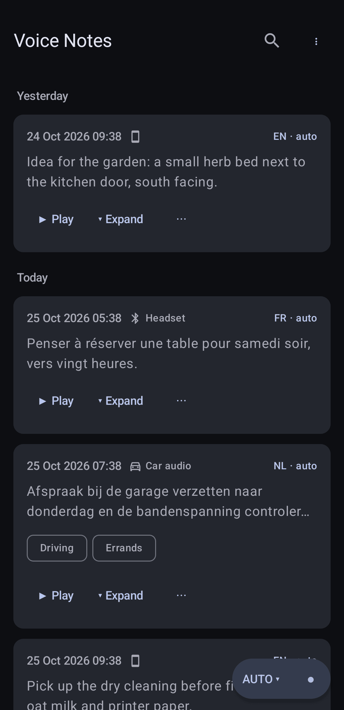
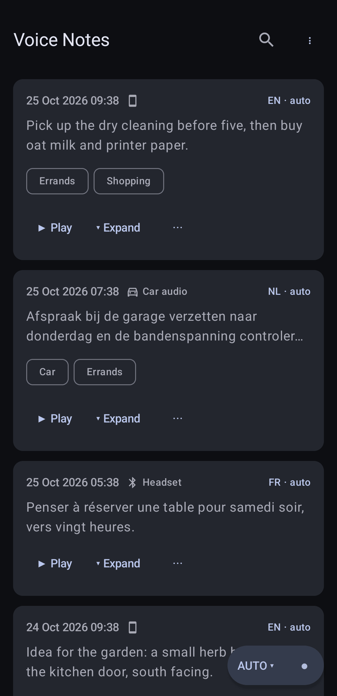
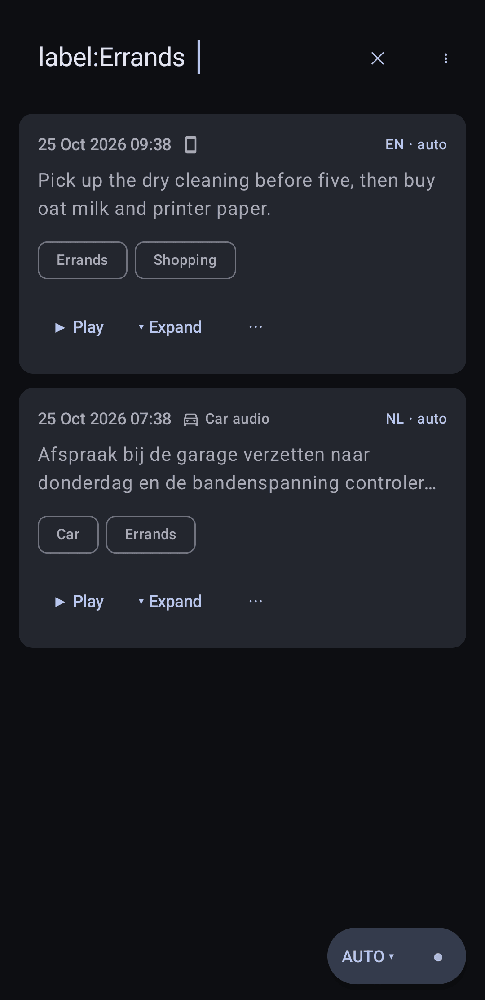
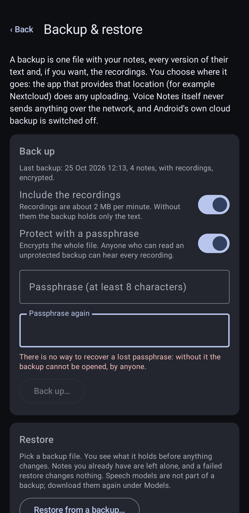

# Voice Notes

A private voice-note recorder for Android, made for use while driving. Start a note with one tap (or a headset
button, or from Android Auto), speak, stop. The speech is turned into text **on the phone**; nothing is uploaded.

> **Status: early development (versions 0.x).** It works well on the developer's own phone, but it has not been
> tested on a wide range of devices, and the limits below matter.

> **Where things live:** the project is developed at <https://tangled.org/sequr.be/voicenotes> (issues and contributions
> go there). The GitHub repository `TheGroundZero/voicenotes` is a read-only mirror, updated automatically, that builds the releases.

## Screenshots

  
  
  
  

More, in light and dark, are in [fastlane/metadata/android/en-US/images/phoneScreenshots](fastlane/metadata/android/en-US/images/phoneScreenshots).
They show invented demo notes, never real recordings.

## Install

There is no app store yet (F-Droid is being looked into). Two ways:

- **[Obtainium](https://obtainium.imranr.dev/)** (recommended, it also updates the app): add the source
  `https://github.com/TheGroundZero/voicenotes`.
- **By hand:** download `voicenotes-X.Y.Z.apk` and its `.sha256` file from the
  [releases](https://github.com/TheGroundZero/voicenotes/releases) page, check the checksum (`sha256sum -c`) and install it.

Every release is signed with the same key, so updates install over the previous version. Its certificate fingerprint
(SHA-256) is `2E:17:59:6E:99:B8:8F:97:0F:FF:56:42:3D:B2:86:44:90:FB:20:88:CF:EC:BB:E8:04:25:5B:88:C4:F1:5E:1E`; check it with
`apksigner verify --print-certs`. A release can also be rebuilt from this source and compared byte for byte
([docs/RELEASING.md](docs/RELEASING.md)). Make a backup (menu → *Backup & restore*) before updating if the notes matter to you.

## What it does

- **Recording from several places:** an in-app button, a Quick Settings tile, a home-screen widget, a Bluetooth
  headset's or car's play/pause button, and Android Auto (as a media app with a Record button).
- **Offline transcription** with [whisper.cpp](https://github.com/ggml-org/whisper.cpp) and OpenAI's Whisper models.
  The language is detected automatically among the languages you prefer (English, Dutch, French and others).
- **Sorting and day headers:** newest or oldest first (menu), remembered, with a header for each day.
- **Labels and search:** label notes yourself and find them again with one search bar: words search the text, `label:name`
  searches the labels only (never the text), and the search suggests your labels as you type `label:`.
- **Several versions of every transcript:** re-transcribe with another model or language, edit by hand, switch back.
- **Speech check:** recordings with no speech (silence, road noise) are not sent to Whisper, which would otherwise
  invent text for them.
- **Battery aware:** transcription waits while the battery is low or battery saver is on, then resumes.
- **Sharing on your terms:** share text or audio, append notes to a Markdown file you choose (for example in an
  Obsidian vault or a Nextcloud folder), or export everything.
- **Backup and restore** to a file you choose (for example in Nextcloud): notes, every transcript version, labels and,
  if you want, the recordings; optionally encrypted with a passphrase ([docs/BACKUP.md](docs/BACKUP.md)).
- **Bluetooth microphone** (optional) to record through a headset or a car's hands-free system.

## Privacy

No account, no analytics, no advertising, no cloud. Recordings and text stay in the app's private storage. The only
network use is downloading a speech model (and a small speech-check model) from huggingface.co, and only when you ask for it. Details: [PRIVACY.md](PRIVACY.md).

## Limits you should know about

- **Android 14 or newer** (`minSdk` 34), **64-bit ARM** phones only.
- The speech code is built in several processor variants and the app chooses the fastest one the phone supports when
  it starts. On a phone with the *i8mm* instructions (ARMv8.6-A or newer, like the developer's Pixel 10) an 11-second
  note takes about 10 seconds; the baseline variant that every 64-bit ARM phone can run is about 2.4 times slower
  (measured on the same Pixel 10 with the baseline forced; older phones have slower processors still). Phones
  without the dot-product instructions have not been tested at all.
- Models are large: 0.5 to 0.9 GB each. The best one (`large-v3-turbo`, 8-bit) needs about a gigabyte of free memory
  and transcribes at roughly real time on a Pixel 10.
- Developed and tested on a Pixel 10 running [GrapheneOS](https://grapheneos.org). Android Auto was tested on the
  Desktop Head Unit, not yet in a car.
- Android Auto only lists apps from Google Play unless you switch on its developer option *Unknown sources*; there is
  no note-taking category, so Voice Notes presents itself as a media app. A plain "play" press never starts a note
  (Android Auto sends one by itself when it connects).
- In the car, start a note with the *Record a note* button on the Android Auto screen. The car's voice button belongs to
  Android Auto's assistant (Google Assistant or Gemini), not to Voice Notes. On a phone without one, for example GrapheneOS
  without Google apps, Android Auto answers that button with "Voice commands are not available at the moment"; that message
  is Android Auto's, and Voice Notes does not need an assistant.

## Building

See [docs/BUILDING.md](docs/BUILDING.md). In short: `scripts/setup-toolchain.sh`, `source env.sh`,
`./gradlew assembleDebug`. How releases are made and checked: [docs/RELEASING.md](docs/RELEASING.md); what comes next:
[docs/ROADMAP.md](docs/ROADMAP.md); how to contribute: [CONTRIBUTING.md](CONTRIBUTING.md).

## Licence

Copyright 2026 The Voice Notes authors (sequr.be). Licensed under the **GNU General Public License, version 3 or (at your
option) any later version**: see [LICENSE](LICENSE). Third-party components and their licences are listed in
[third_party/README.md](third_party/README.md) and in the app (About).
